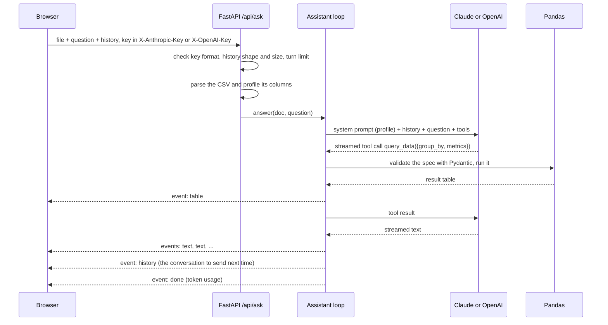

# Quill architecture

This document explains how Quill works under the hood and why it's built the way it is. The [README](../README.md) covers features, setup and configuration.

## The pieces

| Part | Where it runs | What it does |
| --- | --- | --- |
| Front end (`frontend/`) | Served by the same FastAPI app | Static HTML and JavaScript. Holds the uploaded file, the conversation and the visitor's API key, and renders streamed answers, citations, tables and Chart.js charts. |
| API (`backend/app/`) | Vercel Hobby, one Python serverless function (`index.py`) | FastAPI. Checks uploads, validates the conversation the browser sends back, runs the answer loop and streams events over server-sent events. Stores nothing. |
| Model providers | Anthropic or OpenAI, paid by the visitor's own key | Claude through the Messages API, or an OpenAI model through Chat Completions. The header the key arrives in picks the provider. |

The same app runs in three places without changes: on Vercel through `index.py`, in Docker through the `Dockerfile`, and locally through `uvicorn app.main:app`. There is no database, no file storage and no queue.

## A question, end to end

Here's what happens when someone asks "Which region sold the most?" about a CSV:

For a PDF the flow is the same, but the document itself goes to the model with every question, at the start of the first message, and the only tool is `plot_values` (a chart from numbers stated in the document).

### Inside the answer loop

`Assistant.answer()` in `assistant.py` is provider-neutral. Each round it:

1. **Streams one model response** through the provider's `_stream_round()`, passing text (and Claude's citations) to the browser as they arrive. The provider returns a `Round`: a stop reason (`end`, `length` or `refusal`), the assistant message, the tool calls and token usage.
2. **Stops** on a refusal, or on a length cut-off in the middle of a tool call.
3. **Runs each tool call** through `_run_tool()`, which is shared. Input is validated with Pydantic and checked against the real columns. A bad spec becomes an error result that goes back to the model, which fixes the query and tries again.
4. **Adds the results** through the provider's `_tool_messages()` and goes round again, up to `MAX_TOOL_ROUNDS`.

If anything fails, including the browser disconnecting mid-answer, the conversation is cut back to how it was before the question, so the next question starts from a valid history.

### What each provider does differently

| | Claude (`ClaudeAssistant`) | OpenAI (`OpenAIAssistant`) |
| --- | --- | --- |
| API | Messages API, streamed | Chat Completions, streamed |
| PDF input | `document` block with citations on | `file` part with the PDF as base64 |
| Pages behind an answer | Built-in citations (page range and quoted text) | The prompt asks for "(p. 3)" style references in the text |
| Prompt caching | Explicit `cache_control` on the document and the latest message | Automatic for a repeated prefix |
| Tools | `tools` with `input_schema` | The same schemas wrapped as function tools |
| Tool results | One user message with `tool_result` blocks | One `tool` message per call |
| Declined requests | Server-side fallback to another model | Shown as "OpenAI declined to answer" |
| History kept by the browser | Anthropic content blocks | Chat Completions messages |

The two history formats aren't interchangeable, so a conversation can't move between providers. The server refuses a history in the wrong shape, and the front end starts a new chat when the visitor swaps to a key from the other provider.

## Data model

There's no database. Everything lives in the request:

| Thing | Where it lives | Notes |
| --- | --- | --- |
| Uploaded file | Browser memory, sent with each question | Parsed in memory on every request, never written to disk |
| Conversation | Browser memory, sent back as `history` | Validated on every request; for PDFs the document block is added by the server, so the browser's copy stays small |
| API key | `sessionStorage` for that tab | Sent in a header; never stored or logged by the server |
| `Document` | One request on the server | Kind, file name, PDF bytes or a DataFrame plus its profile, and the messages |

## Security model

- **No code execution.** The model never sends code. CSV analysis runs from a JSON spec that Pydantic validates, with column names checked against the DataFrame. There is no `eval`, so a prompt hidden in a cell can't run anything.
- **Prompt injection.** Both system prompts tell the model to treat the document's contents as material to analyse, not as instructions. The worst a hostile file can do is steer the answer about that file.
- **Keys.** A visitor's key is used for that request only. Its prefix is checked before it's sent anywhere (`sk-ant-` for Anthropic, `sk-` but not `sk-ant-` for OpenAI), so a key pasted in the wrong place doesn't reach the other provider. Sending both headers at once is refused.
- **History from the browser is untrusted.** `_parse_history()` checks every message's role, order and fields. A Claude history may only contain text, tool use, tool result and thinking blocks; documents are added by the server. An OpenAI history may not contain system messages or file parts, and every tool result must answer a tool call. Its size is capped by `MAX_HISTORY_KB` and its length by `MAX_TURNS_PER_DOCUMENT`.
- **Uploads** are capped by size, PDF pages and CSV rows. Encrypted PDFs are refused.
- **Cost.** With bring your own key the server pays for nothing. When a server key is set, questions are rate-limited per client IP.
- **CORS** allows only the configured front-end origins and the two key headers.

## Key decisions

| Decision | What we chose | What we rejected, and why |
| --- | --- | --- |
| CSV analysis | Tools with a validated JSON query spec, run with Pandas | **Letting the model write Python:** needs a sandbox and is open to prompt injection from the data. **Sending the whole table to the model:** costly, limited by context size, and the model would do arithmetic in its head. |
| State | Stateless server; the browser keeps the file and the conversation | **Server-side sessions:** need a store, and serverless instances don't share memory. This was a change from the first in-memory design when the app moved to Vercel. |
| Who pays for answers | Bring your own key, kept in the visitor's tab | **A server key:** the brief was zero spending, and a public demo with a paid key can be run up by anyone. |
| Second provider | OpenAI next to Claude, chosen by the key the visitor pastes | **A provider dropdown:** one more thing to get wrong, when the key prefix already says which provider it is. **A wrapper library such as LiteLLM:** hides the differences that matter here (citations, caching, PDF input) and adds a large dependency to a serverless bundle. |
| OpenAI API | Chat Completions | **The Responses API:** fine too, but Chat Completions is the format most OpenAI-compatible providers accept, so other providers can be added later with little code. |
| Default OpenAI model | `gpt-5.4-mini` | **A larger model:** the visitor pays, and a small model with tools does well on this kind of question. Set `OPENAI_MODEL` to change it. |
| Provider code | One shared loop, with a small subclass per provider | **Two separate loops:** the tool handling, limits and rollback would drift apart. |
| Hosting | Vercel Hobby (free, no card), one Python function | **Render:** asks for a card even on the free plan. **Hugging Face Docker Space:** Docker Spaces aren't free on this account. The Dockerfile stays for any container host. |
| Front end | Plain HTML and JavaScript served by FastAPI | **React:** a single page with one form doesn't need a build step, and serving it from the API keeps it on one origin. |
| Tests | Scripted fakes of both SDK clients | **Calling the real APIs in CI:** costs money and needs a key in CI. The fakes stream chunks in the real shapes, so the parsing code is exercised. |

## Testing strategy

- **API tests** (`backend/tests/test_api.py`) drive the whole app through FastAPI's test client with a scripted Claude fake: uploads, tool calls, citations, rollback on errors and disconnects, history validation, key handling and rate limits.
- **OpenAI tests** (`backend/tests/test_openai.py`) do the same with a scripted OpenAI fake that streams Chat Completions chunks, splitting text and tool arguments into fragments the way the real API does.
- **Query engine tests** (`backend/tests/test_data_tools.py`) cover filters, grouping, time buckets, aggregations and charts on the sample data.
- **CI** (GitHub Actions) runs ruff and pytest, checks the Vercel entrypoint imports, and builds and smoke-tests the Docker image on every push and pull request. No test calls a real API or needs a key.

## Known limits

- **No answer-quality check against the real APIs in CI.** The fakes prove the wiring, not how well each model answers. The live demo was checked by hand with Claude; the OpenAI path still needs a manual check with a real key.
- **OpenAI answers have no clickable citations.** Page references are plain text, and the model can get them wrong.
- **The file is uploaded with every question.** That keeps the server stateless but costs bandwidth, and Vercel caps a request at 4.5 MB, so files are limited to 4 MB.
- **A conversation can't switch providers.** Pasting a key from the other provider starts a new chat.
- **The rate limit for server keys is per serverless instance,** so it's a soft limit.
- **Long answers can hit the function time limit** (300 seconds on Vercel Hobby).
- **Scanned PDFs** depend on the model reading page images; pypdf's text preview will be empty for them.

## What I'd do next

1. **A manual run with an OpenAI key** to check page references and tool use on the samples, then screenshots for the README.
2. **Upload the file once per conversation** with each provider's Files API, so follow-up questions send only the question.
3. **Add other OpenAI-compatible providers** (for example a local model through Ollama) by pointing the OpenAI client at another base URL.
4. **Excel files** next to CSV, through Pandas.
5. **Export a conversation** as Markdown with its tables and charts.
